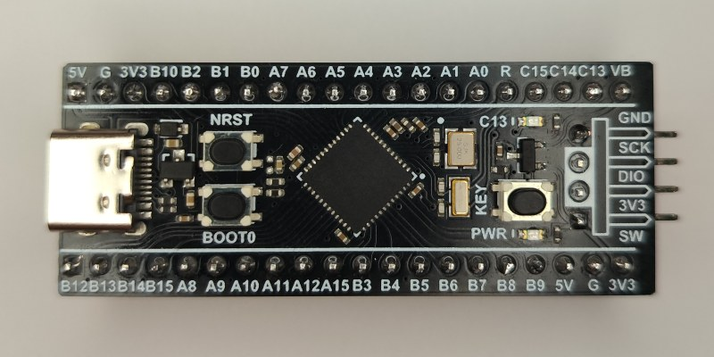
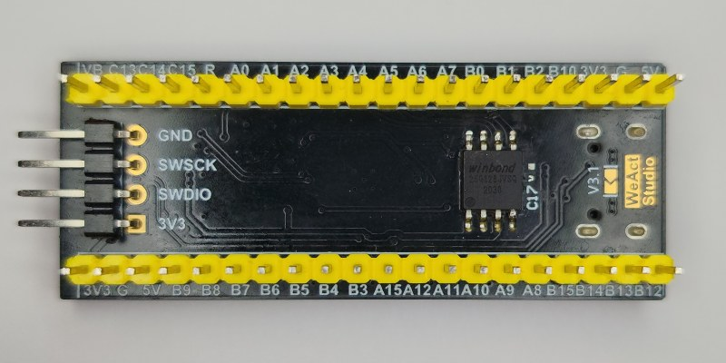

# Black Magic Debug for the WeAct Black Pill STM32U585

[](images/weact_u585_top_large.jpg)

This is a port of [Black Magic Debug](https://black-magic.org/) to the
[WeAct Black Pill STM32U585](https://github.com/WeActStudio/WeActStudio.STM32U585Cx_CoreBoard)
(STM32U585CIU6), loosely based upon the bmp-v3 platform.

This is not an official Black Magic Debug platform.

## Download

Download the latest release from [Releases](../../releases):

- `blackmagic-weact-u585-firmware.bin`: the firmware
- `bmpflash-linux-x86_64`, `bmpflash-windows-x86_64.exe`: bmpflash, for the flasher below

## Install

Connect the Black Pill to usb. Make sure it's a data cable, not a charging cable.

### Windows

- Download [dfu-util](https://dfu-util.sourceforge.net/)
- Push NRST and BOOT0
- Wait a few seconds
- Release NRST
- Wait a few seconds
- Release BOOT0
- Upload the firmware:
```dfu-util -a 0 --dfuse-address 0x08000000:leave -R -D blackmagic-weact-u585-firmware.bin```
- If dfu-util gives the error _Cannot open DFU device xxxx:xxxx_ download [zadig](https://zadig.akeo.ie/),
  select "STM32 Bootloader", install the WinUSB driver and run dfu-util again.
- Disconnect and reconnect to usb

### Linux

- Install dfu-util. On Debian/Ubuntu, type `sudo apt-get install dfu-util`
- Push NRST and BOOT0
- Wait a few seconds
- Release NRST
- Wait a few seconds
- Release BOOT0
- Upload the firmware:
```dfu-util -a 0 --dfuse-address 0x08000000:leave -R -D blackmagic-weact-u585-firmware.bin```
- If dfu-util does not find the black pill, execute dfu-util as root.
- Install [udev rules](https://github.com/blackmagic-debug/blackmagic/tree/main/driver)
- Disconnect and reconnect to usb

### Updating

Once Black Magic Debug runs, no buttons are needed to update: `dfu-util -d 1d50:6018 -e` switches the
probe to the ST bootloader, then upload the new firmware with the same command as above.

## Pinout

|Signal|Pin|
|---|---|
|SWDIO / TMS|PB12|
|SWCLK / TCK|PB13|
|TDI|PB15|
|TDO|PB14|
|SWO|PA1|
|nRST|PA15|
|UART1 TX / RX|PA2 / PA3|
|UART2 TX / RX|PA9 / PA10|

Connect GND, and 3V3 if the target is powered from the probe.
Targets must be 3.3V: the pins connect directly to the STM32U585, there are no level translators.

The blue LED (PC13) shows idle/running, errors and UART activity.

## Additionally

Compared to upstream, the following additions:

- [DWT](https://github.com/koendv/arm_can_tool/blob/main/doc/DEBUG.md#dwt)
- [MTB](https://github.com/koendv/arm_can_tool/blob/main/doc/DEBUG.md#mtb)
- [Memwatch](https://github.com/koendv/arm_can_tool/blob/main/doc/DEBUG.md#memwatch--live-memory-monitoring)
- [Speed test](https://github.com/koendv/arm_can_tool/blob/main/doc/DEVELOPER.md#speed-test)
- RTT and memwatch read target memory without halting the target on Cortex-M, except TI Stellaris/Tiva-C.
  RISC-V targets are read without halting if the debug module has System Bus Access.
  Other RISC-V and Cortex-A/R targets are halted.
  Override with `mon mem_nohalt enable|disable`.
- `mon clocks` shows whether the 25 MHz and 32.768 kHz crystals are running. Used for debugging the port.
- `mon flasher [info|write]` list the image in the on-board SPI Flash, or program a target from on-board SPI Flash.

## Flasher

This build adds standalone flashing: the probe programs a target from an image stored in a flash chip on
the board, without a pc.

[](images/weact_u585_bottom_large.jpg)

Standalone flashing requires adding a flash chip to the board.

- solder a SPI flash to the pads on the bottom of the pcb. E.g.: Winbond
  [W25Q128JVSIQ](https://www.lcsc.com/product-detail/C97521.html).
- optionally solder C17 100nF, or a 100 nF leaded capacitor between pin 4 and pin 8.
- use `bmpflash provision firmware.elf` to write an image from pc to bmp.
- connect bmp to target swd or jtag
- push and hold pushbutton `KEY` for about one second to program the target.
- while programming, the LED blinks fast. When done, the LED stays on; on an error it blinks an error code.

## More

- [NOTES.md](NOTES.md): building, the patches, measurements and test results
- [cubemx/](cubemx/): STM32CubeMX project with the pin and clock configuration
- [Schematic](https://github.com/WeActStudio/WeActStudio.STM32U585Cx_CoreBoard/blob/master/Hardware/WeActStudio.STM32U585Cx_CoreBoard%20SchDoc.pdf) of the WeAct board
- Parts of code and documentation LLM-generated

## License

Black Magic Debug is licensed GPL-3.0-or-later. bmpflash is licensed BSD-3-Clause.

This repository's own files are CC0; the patches follow the license of the files they change. See [LICENSE](LICENSE).
